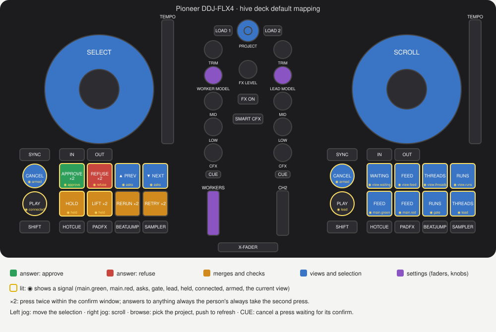

# deck

An optional Hive module that turns a USB MIDI controller (first: Ihsan's Pioneer DDJ-FLX4) into a command surface for the Hive, run on the laptop where the controller is plugged in.

- `cmd/deck`: the program (`deck check` first on a new laptop, then `deck --dry-run` and `deck`)
- `check/`: `deck check`, the profile against the real device
- `surface/`: the controller's MIDI map, as a profile (`profiles/ddj-flx4.json`)
- `deck/`: the actions and lights, and the default mapping (`default.json`)
- `hive/`: the slice of the Hive's API the deck uses, with the person's token
- `midi/`: USB MIDI on Linux (ALSA raw MIDI), macOS (CoreMIDI) and Windows (winmm)

How to run it, the default layout and how to change it: [docs/README.md](docs/README.md).

